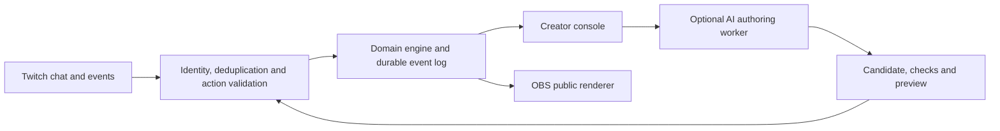

**Codex x TwitchCon: research, technology strategy, and nine product concepts**

Researched on 24 October 2026, using Africa/Lagos for local dates. Three parallel research workstreams covered Twitch infrastructure and audience mechanics, the brief and collaboration products, and content enhancements and existing tools. A fourth workstream checked official OpenAI documentation. We then challenged the ideas against existing products, practical integration limits, and the published judging criteria.

My first prototype choice is **Signal Salvage**: a streamer's missing instruments are operated by viewers. **Falsification League** is the strongest departure from ordinary streamer software. **Rumor Engine** offers the best combination of a bounded build and repeat storytelling value. **Raid Relay Studio** is especially attractive if two willing streamers are already available. These are concept-stage judgments, not predictions about winners.

**Evidence and access.** Direct requests to Devpost were blocked. Search returned substantial indexed text from the exact official overview, resources, rules, and schedule URLs; those are the basis of the brief findings. Technical findings use opened official documentation, and competitive checks use the products' own sites. No API integration, account eligibility, runtime cost, or latency was empirically tested. Proposed names and product mechanics are our analysis; the prior-art search cannot prove global novelty.

**The brief changes how we should choose.** The resources identify **streamer collaboration**, **audience participation**, and **content enhancements** as suggested directions. They are starting points, rather than separately awarded tracks. I found no published sponsor bounty tracks in the retrieved material. Accordingly, the nine concepts below are grouped three per direction for comparison; they compete under the same rubric. [Resources](https://twitchcon-codex.devpost.com/resources)

The event pairs Twitch and OpenAI around building with Codex. The advertised pool is $25,000, with the top five showcased at TwitchCon. Runtime OpenAI API usage is not stated as a requirement. [Overview](https://twitchcon-codex.devpost.com/)

The legal sponsor is Amazon Advertising LLC. The rules require a new, working, interactive Twitch-connected project built during the entry window with Codex. Submission includes a runnable repository, project/Codex explanation, main build-session ID, and a YouTube demo under three minutes showing Twitch functionality and Codex use. Innovation, impact, implementation/Codex use, and design are equally weighted. This gives each a 25% share; adding technologies does not itself satisfy any criterion. [Rules](https://twitchcon-codex.devpost.com/rules)

The listed deadline is **2 November 2026, 2 p.m. PST**, which converts to **10 p.m. UTC / 11 p.m. Lagos**. I independently checked the date-specific Pacific conversion. The FAQ's UTC conversion is one hour earlier, and the schedule's judging dates differ from the rules. Use the Pacific deadline and recheck the live countdown; plan to finish submission a day early. The rules say they prevail over conflicting promotional details. [Rules](https://twitchcon-codex.devpost.com/rules), [schedule](https://twitchcon-codex.devpost.com/details/dates)

**What the technology actually makes possible.** The useful combination is Twitch identity and events, an application that computes reliable consequences, a public renderer, and optional AI for a specific creative task. It need not be a chatbot.

| Technology | Useful capability | Boundary that changes the product |
|---|---|---|
| Twitch Chat + EventSub | Receive authenticated viewer actions and stream events; use Helix when sending messages. | Acknowledge most actions visually. Do not make a bot reply for every incoming message. [Chat](https://dev.twitch.tv/docs/chat/) |
| EventSub WebSocket | Relatively small single-channel integration with a user-token flow. | Deduplicate deliveries and distinguish planned reconnects from outages. Missed outage events are not replayed. [WebSocket guide](https://dev.twitch.tv/docs/eventsub/handling-websocket-events/) |
| Shared Chat metadata | Preserve the originating channel and original message for cross-channel mechanics. | An origin channel is not proof of permanent community membership; one echoed message must count once. [Payloads](https://dev.twitch.tv/docs/eventsub/eventsub-reference/) |
| Twitch raid events | Confirm that a channel-to-channel raid happened. | No individual attendee manifest or built-in transfer of our artifact. Our service owns the handoff state and consent. [Raids](https://dev.twitch.tv/docs/api/raids/) |
| OBS Browser Source | Render a web scene, animation, state display, and original audio in the broadcast. | These become broadcast pixels. Viewers cannot click a source rendered in the stream. [OBS](https://obsproject.com/kb/browser-source) |
| Twitch Extension | Deliver an actual interactive interface to viewers. | Public review is currently estimated at 8–14 days; test versions have restricted visibility. Make chat + OBS sufficient for the demo. [Lifecycle](https://dev.twitch.tv/docs/extensions/life-cycle/) |
| Polls and Channel Points | Familiar optional controls for eligible creator accounts. | Eligibility/documentation differs by feature; do not make monetization status necessary for participation. Use free commands and app-owned round budgets first. [Polls](https://dev.twitch.tv/docs/api/polls/), [Channel Points](https://help.twitch.tv/s/article/channel-points-faq) |
| Codex development | Build the adapter, state engine, interface, and meaningful verification with a reviewable session. | Demonstrate the development process; a runtime agent is a separate feature claim. |
| Codex SDK / noninteractive mode | Start/resume a bounded authoring task; obtain structured output and observe a build/revision workflow. | Auth, worker environment, task duration, and rollback are real implementation work. Use between acts. [SDK](https://developers.openai.com/codex/sdk/), [noninteractive mode](https://developers.openai.com/codex/noninteractive/) |
| Structured Outputs / function calling | Convert an accepted human brief into a typed candidate, or request an approved application action. | Valid output shape does not prove correctness, fairness, permission, or solvability. The app validates and applies changes. [Structured Outputs](https://developers.openai.com/api/docs/guides/structured-outputs), [tools](https://developers.openai.com/api/docs/guides/function-calling) |
| Vision and audio | Interpret selected images, transcribe consented speech, or add a short generated voice. | Twitch metadata is not a raw-media feed. Use creator-selected capture or actual game telemetry; confirm consequential observations. [Vision](https://developers.openai.com/api/docs/guides/images-vision), [audio](https://developers.openai.com/api/docs/guides/audio) |

**Timing should shape the interaction.** Chat events and a viewer's delayed video are different timelines. Proposed planning windows of 20–30 seconds, explicit round IDs, and separate resolution phases are product choices that tolerate this. They are not latency guarantees. Avoid rewarding millisecond reactions to a Twitch frame. A game can animate at normal speed locally while accepting audience interventions only at clear checkpoints. Twitch's player/Extension interfaces expose latency information, but that is not a universal shared clock. [Player reference](https://dev.twitch.tv/docs/embed/video-and-clips/), [Extension reference](https://dev.twitch.tv/docs/extensions/reference/)

**The competitive bar is already high.** Crowd Control covers game interference and custom disruptions; Stream Avatars covers viewer characters and group minigames; Streamer.bot covers extensive event automation and remote triggers; RaidPal and R3dLabs cover raid-event coordination. The proposed distinction has to be visible in the mechanic. A new title or an LLM-generated description is insufficient. [Crowd Control](https://crowdcontrol.live/), [Stream Avatars](https://www.streamavatars.com/), [Streamer.bot Remote](https://docs.streamer.bot/examples/remote-triggers), [RaidPal](https://raidpal.com/en/how-to-raid-on-twitch-what-is-a-raid-train), [R3dLabs](https://r3dlabs.com/events)

**Streamer collaboration — C1. Raid Relay Studio.** A raid carries a creative work that the next streamer can continue.

Imagine an artist making a tiny animated island. Her viewers add a creature behavior. When she raids a musician, the island arrives with its artwork and contribution history; he adds an original rhythm and a moving bridge. The next streamer receives a changed world rather than a blank opening. A weekly creator collective ends with an artifact that records who made each piece.

The key mechanic is a versioned handoff: sender locks a checkpoint, recipient previews and accepts it, and the expected real raid event unlocks the next edit leg. Twitch does not transfer the artifact; our service does. A canceled raid leaves the checkpoint pending. The destination needs explicit authorization and ownership of a meaningful next transformation.

Use chat, EventSub raids, broadcaster accounts, an artifact store, and OBS renderers. Codex builds the custody state machine, scene editor, history and recovery. An optional runtime Codex task can propose a bounded scene patch from the next creator's brief; it adds value only if preparing that patch is part of the show.

**MVP:** two real streamers, one 2D diorama, shape/behavior/sound-pattern edits, accepted handoff, immutable revisions, and resume after restart. Native raid initiation is sufficient. No scheduling marketplace or universal creative-file format.

**Demo moment:** the creature visibly travels between actual Twitch streams; the recipient adds a trait that transforms the scene; a lineage scrubber shows both contributions. This creates a stronger reason to follow the raid than a generic welcome badge.

**Weakness:** without substantive continuation, this becomes raid scheduling with decorative graphics. Recruit collaborators before building the editor. It is a strong practical product if a real collective wants to use it. Prior art and implementation details: [collaboration research](brief-and-collaboration.md).

**Streamer collaboration — C2. Threefold Studio.** Several creators supply different parts of one living toy; a bounded Codex build step assembles the result between acts.

An artist draws a paper fox, a storyteller gives it a behavior, and a musician gives it a rhythm. They watch a shared preview become interactive: the fox hides when an approved chat token arrives, then its rhythm changes when it reappears. Each person controls a different creative layer, so their work remains recognizable.

The product supplies typed interfaces between those layers: stable shape IDs, a small behavior grammar, and a step sequencer. A creator-approved brief goes into a scoped Codex task; it proposes a declarative scene patch, runs checks, and returns a diff and preview. The previously approved scene stays live until the next version is accepted. If the worker fails, the show continues on that version.

This is the clearest opportunity for additional **runtime Codex integration**. The product turns making, testing, and revising software into a shared performance. The renderer interprets approved data; arbitrary viewer JavaScript never becomes the scene runtime. A real source-code-editing demo would require a separate disposable build environment and actual build verification.

**MVP:** two creators first, one scene, five entities, five approved event types, layer ownership, staged preview, revision approval and rollback. Add the musician's sequencer only after the two-layer interaction works. Stream Together can handle conversation; our product provides the joint artifact.

**Demo moment:** show the static fox, its newly proposed behavior, one failed check, a corrected preview, and both streams reacting to the same approved revision. Compare each layer alone with the combined result.

**Weakness:** variable generation time and visually muddy causality can flatten the performance. Prove a narrow worker path early. A generic prompt-to-game generator would be a much larger project. Supporting research: [collaboration](brief-and-collaboration.md), [OpenAI capabilities](openai-capabilities.md).

**Streamer collaboration — C3. Handshake Studio.** Two chats invent an executable shared greeting by learning each other's contribution.

Channel A contributes a spark token; channel B contributes wind. Creators approve their meanings. B must demonstrate A's spark, A must demonstrate B's wind, and distinct contributors from both origins complete the final build step. Their separate crests turn into one flying lantern, saved as the pair's greeting for future collaborations.

The distinctive mechanism is bilateral authorship and teach-back, followed by an executable three-step ritual. Sequence and different roles matter. A flood of messages from one origin cannot replace the other origin's action. The software counts distinct accounts globally per stage and deduplicates Shared Chat copies; it does not claim to establish who is a genuine community member.

Use source-aware EventSub messages, a finite-state matcher, creator approvals, stored ritual revisions and an OBS animation. Codex builds and checks the matcher. An optional between-scene task can propose a variation and test for unreachable stages; a plain form is enough initially. Free commands work without points or native polls.

**MVP:** two channels, one fixed three-stage template, original/approved tokens, forgiving windows, tiny per-origin quorums, rehearsal, one shared crest and replay. Allow thresholds to match the actual small pilot rather than requiring a large crowd.

**Demo moment:** one-sided spam fails; each chat performs the other's half; the lantern appears; the same saved greeting works during a later raid.

**Weakness:** this is the most experimental collaboration product. It may be a memorable opening ceremony or a disposable command puzzle. Ask two actual creator communities to author and reuse a ritual before committing the full build window. Supporting research: [collaboration](brief-and-collaboration.md).

**Audience participation — A1. Signal Salvage.** Viewers operate the instruments that the streamer is missing.

The streamer pilots a damaged salvage submarine with an incomplete cockpit. The public broadcast carries a sonar layer absent from that cockpit. Viewers take sonar, power, and engineering roles: probing map cells, wiring relays and allocating the battery that makes instruments work. The captain can move, but the crew's work supplies the information required for a rescue.

This is parallel problem-solving with individually useful actions. One viewer discovers an obstacle, another powers the correct scanner, and a third repairs the path. Their contributions become a shared instrument that the host must interpret. A large majority cannot replace the missing engineering connection simply by repeating a direction.

Information-asymmetric cooperation already exists in games such as *Keep Talking and Nobody Explodes*. The proposed difference is a Twitch-native crowd doing complementary, credited work that changes the instruments themselves, using a deliberate planning cadence. Do not pitch information asymmetry as a new invention. [Existing game](https://keeptalkinggame.com/)

Use one server state with separate private cockpit and public overlay routes. Free EventSub commands carry round IDs; the application enforces role budgets. Codex builds the reducer, puzzles, dual renderers and recovery. Runtime AI is unnecessary; optional salvage-log narration can follow a successful rescue.

**MVP:** one authored 12×12 wreck map, three station roles, three hazards and planning/resolution phases. Let a small group switch stations between rounds. Information separation is an explicit game convention: a streamer could inspect their own broadcast, so hide the preview rather than claiming technical secrecy.

**Demo moment:** a viewer reveals a blocked corridor, another reconnects a relay, and the captain rescues an artifact through the newly discovered route. Credit the indispensable actions. The hardest part is one excellent puzzle, not adding more integrations. Supporting research: [audience concepts](twitch-technology-and-participation.md).

**Audience participation — A2. Amendment Engine.** Chat writes, previews and repairs the laws governing a tiny world.

Viewers contribute bounded rules such as “red tiles bounce,” “the lantern makes this bridge solid,” and “switch B opens gate A.” The server composes them and shows ghost consequences. A helpful bridge law unexpectedly blocks a door because of another clause; the audience changes one condition and the streamer attempts the revised world. Approved laws remain in a public constitution with authors and revision history.

The creative opportunity is collective rule debugging: minority contributions can combine into a successful system, and mistakes create visible explanations. *Baba Is You* already establishes rule-changing puzzle play. Our distinction must be social coauthorship, compositional previews, negotiation and a persistent constitution. [Publisher's game page](https://hempuli.itch.io/baba)

Use a discrete turn-based grid with a fixed grammar, a rules interpreter, a bounded reachability check, stored revisions and an OBS renderer. Codex builds the interpreter and helps expose a genuine failed rule interaction. Optional model calls translate accepted natural-language proposals into existing rule cards; the application validates them.

**MVP:** three predicates, three effects, one small level, a low active-rule limit, a second-person co-sign where the crowd permits, streamer ratification and rollback. Check reachable states within that small world; do not promise arbitrary programs are solvable. No submitted code is evaluated.

**Demo moment:** the preview exposes a contradiction, two viewers repair it, and the host crosses the gap under their jointly authored law.

**Weakness:** unrestricted rules create an impossible authoring project. If the first level needs lengthy explanation, reduce the grammar. Strong Codex engineering story; more gameplay-design risk than Signal Salvage. Supporting research: [audience concepts](twitch-technology-and-participation.md).

**Audience participation — A3. Chat Naturalist.** Viewers design an ecosystem and inherit its consequences across streams.

The community maintains a small island with competing species. Viewers contribute traits under a strict budget: water storage improves drought survival but slows movement; night vision finds food later but costs energy. The streamer starts a new season or attempts one rescue. A generation resolves quickly, and the lineage tree shows whose earlier mutation produced an unexpected survivor.

The core is causal history rather than cosmetic ownership. A newcomer can improve an overlooked lineage. A popular species cannot acquire every advantage because the resource and trait budgets remain fixed. The ecosystem persists, giving the next stream a specific world to revisit. It is an artificial toy model, with visible rules, not a claim about biological realism.

Use a deterministic grid simulation, fixed trait interactions, free per-round contributions, snapshots, lineages and an OBS renderer. Codex builds the simulation, replay and attribution. Optional language generation names species or writes field-guide entries from actual outcomes; it does not invent survival results.

**MVP:** three traits, two resources, three species, one island, one environmental shift and roughly ten-second generation animations. Seed populations are labeled as authored defaults. Small crowds can contribute across multiple rounds. Preserve lineage history between sessions.

**Demo moment:** the fast species initially dominates; drought arrives; a previously ignored water-storing lineage survives; its family tree credits the viewers whose contributions mattered.

**Weakness:** opaque balancing turns this into arbitrary outcomes, and long simulation waits spoil the stream. Prove one understandable tradeoff before adding more genetics. Stream Avatars already covers viewer characters and minigames, so lineage and ecology must be visible. [Prior art](https://www.streamavatars.com/), [detailed concept](twitch-technology-and-participation.md).

**Content enhancements — E1. Falsification League.** Viewers design the experiments that determine what evidence the stream discovers.

Start a science episode with a pendulum and three deliberately different educational models: period depends mainly on mass, mainly on length, or strongly on both. Viewers see each model's prediction for allowed trials. A viewer uses a limited experiment slot to propose a controlled pair: change mass while holding length fixed. Another can improve the control before the host accepts and performs it.

The model predictions are committed before the trial. The host records measured periods; a plot compares observations and uncertainty with the competing predictions. The next viewer chooses a test where the surviving explanations disagree most. The audience's agency is in creating discriminating evidence, rather than voting for the most popular theory or betting on an outcome.

Use typed experimental parameters, authored mathematical models, a creator acceptance step, confirmed measurements, an evidence ledger and an OBS plot. Codex builds unit checks, trial validation, plotting and replay. Runtime AI may phrase an explanation after the result; it is not the measurement authority. Start with manual timer input. Camera tracking is an extension after the basic experiment works.

**MVP:** one household experiment pack, fixed practical parameter ranges, three models, paired trials and data export. No autonomous equipment control or arbitrary science understanding. Two trials update evidence; they do not prove a universal scientific law.

**Demo moment:** viewers propose the mass control and then a length change; real observations alter the public evidence board within the demo. End on the experimenter's credited contribution and the next unresolved question.

**Weakness:** pacing and measurement quality matter more than APIs. A presenter should demonstrate one trustworthy, visible trial in under a minute before software work expands. Best choice for a science/maker creator who wants a new recurring format. Supporting research: [content concepts](content-enhancements-and-landscape.md).

**Content enhancements — E2. Ghost Branch.** Viewers run the route that the streamer did not take.

In an original courier grid game, the host runs out of battery after choosing a short route. Viewers fork the saved junction and submit different short action sequences. A worker restores the exact map, tick, energy and random-generator state, executes each alternative and displays the resulting ghosts beside the original. One detour reaches a battery and succeeds; the host uses that discovery on the next attempt.

Unlike speculative coaching, the product provides an executed counterfactual within a supported simulation. Individual viewers author alternatives, so a minority strategy can become useful without winning a vote. Ghosts and replay are established game ideas; the proposed product is a Twitch spectator interface for submitting, comparing and attributing branches from a shared checkpoint.

Use an original deterministic game or an explicitly supported adapter with `serialize`, `restore`, `step` and `render`. Codex builds and verifies simulation and replay, including a real state/RNG bug if one occurs. Runtime AI adds little to the core and can be omitted.

**MVP:** one attractive microgame, two levels/checkpoints, five branch slots and sequences of about ten actions. The authoritative live state and branch states are separate. Verify identical state/input replays produce identical hashes; rotate branch slots so speed or spam does not own every attempt.

**Demo moment:** show the failed original and a successful alternate side by side, labeled with their shared checkpoint and changed inputs, then show the host apply the insight.

**Weakness:** Twitch and OBS do not provide commercial-game rewind or exact hidden state. A universal game coach is outside scope. Shipping both a worthwhile game and a replay tool is the main delivery risk. Strong technical-team alternative. Supporting research: [content concepts](content-enhancements-and-landscape.md).

**Content enhancements — E3. Rumor Engine.** Tabletop spectators decide who learns which clue; the human GM performs the consequences.

In an original clockwork-heist mystery, the Guard, Apprentice and Broker have different knowledge and schedules. The GM releases clue cards. Viewers spend scarce messenger actions routing a clue to a specific NPC. A door clue changes the Guard's patrol; a late-bell clue changes the Broker's meeting. Together, two independent messages cause an encounter that nobody selected from an ending poll.

The product makes truth, disclosed evidence and each character's knowledge separate objects. The public knowledge graph shows which message caused a reaction. The GM sees a concise proposed scene consequence and can accept or undo it before performing the dialogue. Spectators shape information flow while the GM keeps pacing and narrative authority.

Use chat commands over approved clue/NPC IDs, an authored consequence engine, a private truth ledger, a public graph and a GM preview console. Codex builds the schema, state engine and secrecy/rollback checks. Optional AI drafts dialogue using only facts permitted for that NPC; the human approves it. A model prompt alone does not enforce the private/public boundary.

**MVP:** three NPCs, six clues, two scenes and eight authored consequence rules. The actual demonstration can reveal only two clues and one clear consequence. Rotate messenger slots rather than allowing only the fastest users to participate. Use original setting and art.

**Demo moment:** two minority-delivered clues animate along separate graph paths; the GM advances the scene; the resulting Guard–Broker encounter explains both viewers' influence.

**Weakness:** bookkeeping can interrupt performance. Keep the console to one consequence card per scene. This is a strong build if a good human storyteller can join the demo, and a plausible recurring tool for mysteries, actual play and improv. Supporting research: [content concepts](content-enhancements-and-landscape.md).

**Sponsor integration should serve the mechanic.** No separate sponsor prizes were verified. Amazon's legal-sponsor role does not establish an AWS requirement. Optional hosting or database products can be selected on practical grounds. Codex development and a real Twitch interaction are the common foundation.

| Concept | Twitch's essential role | Best additional OpenAI role, if built |
|---|---|---|
| Raid Relay Studio | Actual raid plus authorized creative handoff | Propose a next-leg scene patch from the accepted brief. |
| Threefold Studio | Distinct creator/chat layers appear in real streams | Codex SDK/CLI worker proposes, checks and previews a bounded manifest revision. |
| Handshake Studio | Source-aware cross-channel sequence and distinct-user actions | Check a proposed ritual revision between scenes; ordinary forms also work. |
| Signal Salvage | Crowd performs the missing instruments during live play | Optional short logs after resolution. Prioritize the game first. |
| Amendment Engine | Viewers coauthor the rules the host actually plays under | Translate natural language to supported cards; validate in code. |
| Chat Naturalist | Identity, persistent contribution and seasonal participation | Name and describe lineages from real simulation results. |
| Falsification League | Viewers author tests performed by the creator | Explain confirmed results; future vision can propose observations for confirmation. |
| Ghost Branch | Viewers submit real executable alternate inputs | Describe verified branches. Simulation remains authoritative. |
| Rumor Engine | Viewers route knowledge that changes a performed scene | Draft NPC-specific dialogue from a deliberately restricted knowledge payload. |

**A shared architecture keeps scope credible.** A TypeScript service, durable event store, browser dashboard and Canvas/SVG overlay are enough for the first version. Use a host that supports the actual long-lived sockets and optional workers. Do not choose a deployment because it serves a static page and assume it also runs a continuous EventSub listener.

Keep the hot interaction loop in application code. Model output proposes content or actions; the engine decides what actually changes. A renderer reload recovers state from the service. A disconnect pauses the current round visibly. A proposed Codex revision does not replace the live scene until checked and accepted. These design choices make the three-minute demonstration more reliable and make the product easier for streamers to trust.

**My shortlist and the condition for choosing each.** These assessments apply the four equal judging criteria qualitatively and add delivery risk as a planning consideration.

| Concept | Why select it | Main condition to prove | Delivery risk |
|---|---|---|---|
| Signal Salvage | Clearest entertaining dependence between host and audience | Two real viewers perform different indispensable jobs in one round. | Medium: puzzle design. |
| Falsification League | Most unusual reusable show format | One genuine trial produces meaningful, credible data quickly. | Medium: presenter and measurements. |
| Rumor Engine | Strong mix of novel agency, bounded implementation and repeat use | Two routed clues cause one instantly understandable scene. | Medium: performance and authoring. |
| Raid Relay Studio | Strong Twitch dependence and creator-collective utility | Two authorized streamers genuinely continue the same work. | Medium: collaborator access and handoff. |
| Ghost Branch | Best engineering showcase for a game team | Exact replay and a compelling alternate route work in the first prototype. | Medium–high: game plus tool. |
| Threefold Studio | Best additional runtime Codex story | The narrow worker returns a checked, visually clear revision between acts. | High: execution and pacing. |
| Amendment Engine | Excellent collective-debugging moment | A small grammar yields explainable, surprising interactions. | Medium–high: rule design. |
| Chat Naturalist | Strong persistence and return-to-stream story | One ecological tradeoff is immediately visible and interesting. | Medium–high: balancing and clarity. |
| Handshake Studio | Distinct social experiment for recurring creator duos | People want to author and reuse the ceremony. | Adoption risk high; code moderate. |

If there is no existing creator relationship or specialist skill to guide the choice, I would begin with **Signal Salvage**. If a science presenter is available, test **Falsification League** first. If the team has a GM/performer, **Rumor Engine** may deliver the best finished experience within the remaining window. Stronger creator access can reasonably change this order.

**First-day evidence beats another week of ideation.** Before committing to any one concept, authorize a real channel, accept actions from two actual viewers, render one visible consequence, and show it inside a Twitch stream. In parallel, test its unique uncertainty: a meaningful artifact handoff, an interesting authored puzzle, one measurement, one branch replay, or one performed narrative consequence. Continue only if that small interaction already tells a good story.

**A realistic remaining schedule.** Use 24–25 October for selection and the real Twitch vertical slice; 26–28 October for the one complete domain loop; 29–30 October for creator controls, clarity and recovery; 31 October for a real small-group playtest; 1 November for the final recording and submission draft. Keep 2 November for fixes and submission verification before the deadline. This is a suggested build plan, not an event requirement.

Preserve a frozen submission snapshot and keep the judging version accessible free of charge through judging. The FAQ instructs entrants to leave the submitted repository, video and linked materials unchanged until winners are announced; continue later development in a separate copy. Make the setup instructions and judge access work before the deadline. [Submission FAQ](https://twitchcon-codex.devpost.com/resources)

**The demo should prove four things in under three minutes.** In roughly the first 15 seconds, show the finished interaction and its one-sentence promise. Spend about 90 seconds on real Twitch users causing the distinctive result. Use 25–35 seconds for actual Codex build/debug footage and the resulting improvement. Use the remaining time for creator setup, the repeat-use value and access instructions. Label any simulated load or recorded preview. A clean 2:40 recording leaves some room without depending on judges watching beyond the limit.

Capture Codex development evidence from the beginning: main thread ID, a few real decisions, a failure it helped diagnose, and the verified fix. For testing, prioritize behavior that can actually undermine the concept: duplicate chat delivery, wrong round IDs, disconnect recovery, forbidden public state, rule conflicts, determinism, committed predictions or measurement units. These are meaningful product checks; no implemented product was tested during this research.

**Additional options and complete evidence.** The deeper workstreams include two reserve ideas: **Relayworks**, a cooperative utility-network construction game with per-person component ownership, and **Quilt Compiler**, a creator's physical mosaic constrained by real inventory and already-completed rows. Quilt Compiler needs more targeted competitor research before selection. Keep them as alternatives, rather than combining multiple unfinished modes into the primary product.

- [Brief, collaboration technology, three collaboration concepts and rejected alternatives](brief-and-collaboration.md)
- [Twitch APIs, authorization, event delivery, media limits and audience concepts](twitch-technology-and-participation.md)
- [Content-enhancement technology, existing tools and detailed concepts](content-enhancements-and-landscape.md)
- [OpenAI capabilities, runtime choices and Codex integration boundaries](openai-capabilities.md)

The source links throughout these files point to the actual brief, documentation and product pages supporting the relevant findings. Implementation sizes, demo timings, rankings and proposed combinations are our recommendations, not sponsor promises.
